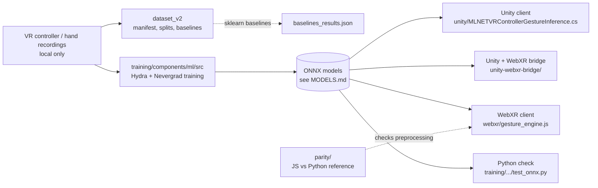

# Architecture

## Pipeline

Which ONNX file is the shipped one, and its exact input contract, is not established by the repository (see `MODELS.md`).

## Preprocessing comparison

All rows describe what the code does today. Line numbers refer to the files at the time of writing.
"Rotate by inverse ref quat" means `inv(q[0]) * (p[i] - p[0])`.

| Aspect | Unity (`unity/MLNETVRControllerGestureInference.cs`) | Bridge C# (`unity-webxr-bridge/MLNETVRControllerGestureInference.cs`) | WebXR JS (`webxr/gesture_engine.js`) | Python reference (`controller_transform.py`, `TSControllerTranslationCoordinateTransform`) |
|---|---|---|---|---|
| Channels | 3 (`ndim = 3`, :31; time written only if `ndim == 4`, :47-49) | 4 (`ndim = 4`, :30; time written at :44-45) | 4 (`[[],[],[],[]]`, :38; tensor dims `[1,4,T]`, :61) | 3 (x,y,z only; :6-17) |
| Subtract first sample | No: raw `gr[i].Position` (:40); `ref_pos` computed (:34) but unused | Yes: `gr[i].Position - ref_pos` (:38) | Yes: `subVectors(pos, refPos)` (:47) | Yes: `y - y[0,...]` (:15) |
| Rotate by inverse ref quat | No: `inv_ref_orient = Quaternion.identity` (:36) | Yes: `Quaternion.Inverse(gr[0].Orientation)` (:34), applied at :38 | Yes: `invRefOrient.invert()` (:42), `applyQuaternion` (:48) | No |
| z flip | No | No | Yes: `transPos.z *= -1.0` (:49) | No |
| Time channel | Not emitted with `ndim = 3` | `gr[i].Time` (:45) | `timestamps[i]` as passed in (:54) | None |
| Tensor layout | `[1, ndim, T]` DenseTensor, feature-major (:33, :44-46) | `[1, ndim, T]` (:32, :41-43) | `[1, 4, T]`, x block then y, z, t (:60-61) | `F x T` (:8-12 docstring, `B x F x T`) |
| Model file | `vr-controller-gestrec-ext-wneg.onnx` default (:16) | same default (:16) | `./pyrocket3.onnx` (:14) | n/a |

Notes on the table:

- The two C# copies are NOT identical (the plan assumed they were). They differ in `ndim`, `inv_ref_orient` and which `trans_pos` line is live.
- `unity-webxr-bridge/gesture_engine.js` is a different engine: it takes an already-transformed 3xT array and does no preprocessing (`inference(ControllerInput)`, :18; tensor `[1,3,T]`, :22-23), loading `./pyrocket2.onnx` (:9). The recordings in `gesture_data_*.json` are in this already-relative 3xT form (first sample is 0).
- The other class in `controller_transform.py`, `TSControllerCoordinateTransform` (:55-117), is a different transform: PCA plane of the trajectory, basis built from world Y and the controller forward vector, origin at the first sample. It is neither the Unity, bridge, nor JS transform and needs the first orientation quaternion, which the JSON recordings do not contain, so it is not reproduced in `parity/`.
- Which of these transforms matches the training data of a given ONNX is not determined by the repository.

## Parity test

`parity/` runs the real `webxr/gesture_engine.js` under Node (three.js from npm, `ort` stubbed to capture the input tensor) and compares it to a NumPy translation reference on one real recording. Known differences are encoded as `xfail(strict=True)` with the exact reason; if one is fixed the test flips to XPASS and fails, forcing the expectation to be updated. C# cannot run outside Unity, so it is compared by reading, in the table above. See `parity/README.md`.
